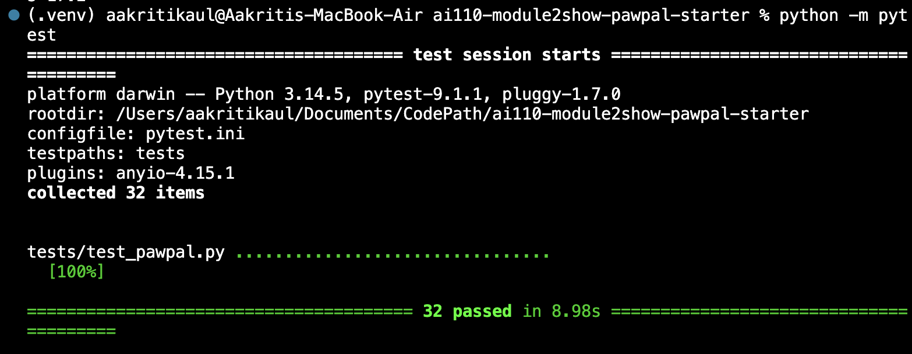
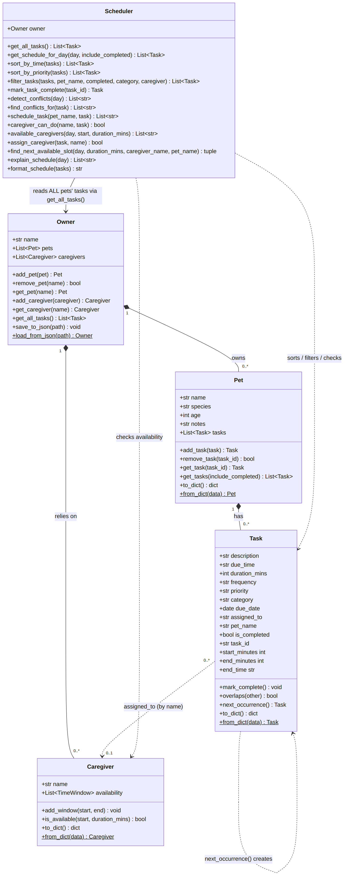

# 🐾 PawPal+ (Module 2 Project)

**PawPal+** is a Streamlit app (with a tested Python logic layer) that helps a busy pet owner stay consistent with pet care. It tracks **walks, feeding, grooming/cleaning, playtime and medication** for **multiple pets**, tells you **who is available** to help at a given time, warns you about **scheduling conflicts**, and automatically creates the next occurrence of **daily/weekly** tasks.

## Scenario

A busy pet owner needs help staying consistent with pet care. They want an assistant that can:

- Track pet care tasks (walks, feeding, meds, enrichment, grooming, etc.)
- Consider constraints (time available, priority, owner preferences)
- Produce a daily plan and explain why it chose that plan

## ✨ Features

| Feature | What it does |
|---|---|
| **Multiple pets** | Add any number of pets (dog, cat, ...). Pet names are unique so tasks are never ambiguous. |
| **Care activities** | Each task has an activity type: 🐕 walk, 🍖 feeding, 🛁 grooming (cleaning), 🎾 play, 💊 meds, 📝 other. |
| **Task details** | Description, date, start time, duration, priority (low/medium/high), repeat (Once/Daily/Weekly), assigned person. |
| **Caregiver availability** | Add yourself and others (family, a dog walker) with daily time windows. Ask *"who is free at 12:30 for 30 min?"* |
| **Next open slot** | Finds the earliest time a person is free (and, optionally, the pet isn't already busy). |
| **Sort by time** | Chronological across all pets (`Scheduler.sort_by_time`). |
| **Sort by priority** | High → low, ties broken by time (`Scheduler.sort_by_priority`). |
| **Filtering** | By pet, completion status, activity and assigned person (`Scheduler.filter_tasks`). |
| **Conflict warnings** | Detects overlapping tasks (same pet, different pets, or one person double-booked) and **warns instead of crashing**. |
| **Recurring tasks** | Completing a Daily/Weekly task creates the next one (+1 day / +7 days) via `timedelta`. |
| **Plan explanation** | `Scheduler.explain_schedule` says why each task is where it is (priority, who, repeats). |
| **Persistence** | Everything is saved to `data.json` and reloaded on the next run. |
| **Friendly output** | Emoji icons, aligned CLI tables, and colour-coded status/warning banners in Streamlit. |

## Project structure

```
pawpal_system.py      # Logic layer: Task, Pet, Caregiver, Owner, Scheduler
app.py                # Streamlit UI (thin client of pawpal_system.py)
main.py               # CLI demo that exercises every feature
tests/test_pawpal.py  # Pytest suite (32 tests)
pytest.ini            # Lets plain `pytest` find pawpal_system.py
diagrams/uml_draft.mmd   # Phase 1 UML (initial design)    -> Mermaid source
diagrams/uml_final.mmd   # Phase 6 UML (matches the code)  -> Mermaid source
reflection.md         # Design + AI collaboration reflection
ai_interactions.md    # Stretch-feature AI documentation
```

## Getting started

### Setup

```bash
python -m venv .venv
source .venv/bin/activate  # Windows PowerShell: .\.venv\Scripts\Activate.ps1
pip install -r requirements.txt
```

### Run the CLI demo

```bash
python main.py
```

### Run the Streamlit app

```bash
streamlit run app.py
```

### Run the tests

```bash
python -m pytest
```

## 🏗️ Implementation summary (how the classes work together)

The design is layered so each class has one job. **Owner → Pet → Task** is the data hierarchy, and the **Scheduler** is the brain that works across all of it.

- **`Task`** (dataclass): one activity. Holds description, `due_time` ("HH:MM"), `due_date`, `duration_mins`, `frequency`, `priority`, `category`, `assigned_to`, and `is_completed`. Methods: `mark_complete()`, `overlaps(other)`, `next_occurrence()` (returns tomorrow's/next week's copy), plus `to_dict`/`from_dict`. It validates its own input (bad times or priorities raise `ValueError`).
- **`Pet`** (dataclass): name, species, age, notes and its **list of tasks**. Methods: `add_task` (stamps the pet's name on the task), `remove_task`, `get_task`, `get_tasks`.
- **`Caregiver`** (dataclass): a person who can do tasks, with daily availability windows. Methods: `add_window`, `is_available(start, duration)`.
- **`Owner`** (dataclass): name, a **list of pets**, and a list of caregivers. Methods: `add_pet` (rejects duplicate names), `get_pet`, `remove_pet`, `add_caregiver`, and **`get_all_tasks()`**, which returns every pet's tasks together. It also owns persistence: `save_to_json` / `load_from_json`.
- **`Scheduler`**: takes an `Owner` and **always reads tasks through `Owner.get_all_tasks()`**, so every feature (sorting, filtering, conflicts, availability) works across **all pets**, never just one. It never stores its own copy of the data.

The Streamlit UI and `main.py` only call these classes; they contain no scheduling rules. In `app.py` the `Owner` lives in `st.session_state` so data survives Streamlit's top-to-bottom reruns.

## 🖥️ Sample Output

Output of `python main.py` (the first part of the demo, today's schedule across two pets, sorted by time even though the tasks were added out of order):

```
2. Today's Schedule (Saturday, October 17) -- sorted by time, all pets
     Time         Pet       Task                Dur  Priority  Who               Done
  --------------------------------------------------------------------------------------
  🍖 07:30-07:40  Luna      Breakfast           10m  high      Jordan            ⬜
  💊 07:40-07:45  Whiskers  Medication          5m   high      Jordan            ⬜
  🐕 12:30-13:00  Luna      Midday walk         30m  medium    Sam (dog walker)  ⬜
  🎾 17:15-17:35  Whiskers  Laser-pointer play  20m  low       -                 ⬜
  🐕 18:00-18:30  Luna      Evening walk        30m  high      Jordan            ⬜
  🛁 20:00-20:40  Luna      Bath                40m  medium    Jordan            ⬜

3. Why this plan?
  07:30 Luna: Breakfast -- high priority, Jordan, repeats daily
  07:40 Whiskers: Medication -- high priority, Jordan, repeats daily
  12:30 Luna: Midday walk -- medium priority, Sam (dog walker), repeats daily
  17:15 Whiskers: Laser-pointer play -- low priority, nobody assigned yet
  18:00 Luna: Evening walk -- high priority, Jordan, repeats daily
  20:00 Luna: Bath -- medium priority, Jordan, repeats weekly
```

The full demo output is in the [Demo Walkthrough](#-demo-walkthrough) below.

## 🧪 Testing PawPal+


```bash
# Run the full test suite:
python -m pytest
```

**What the 32 tests cover**

- **Core classes:** `mark_complete()` changes status; adding a task increases a pet's task count; invalid times/priorities/durations are rejected; duplicate pet names are rejected; `Owner.get_all_tasks()` spans every pet.
- **Sorting:** chronological order across pets (including `09:05` vs `12:30` string-order traps), dates before times, priority-then-time, per-day schedule.
- **Filtering:** by pet (case-insensitive), completion status, activity, caregiver, and combinations.
- **Recurring tasks:** Daily → next day, Weekly → +7 days, month/year rollover (Dec 31 → Jan 1), "Once" tasks don't recur, completing twice doesn't duplicate.
- **Conflict detection:** identical start times, partial overlaps, back-to-back tasks are *not* conflicts, completed tasks and other dates are ignored, caregiver double-booking is reported, conflicts warn but never block.
- **Availability:** windows vs. bookings, assigning only available people, next-open-slot (and `None` when impossible).
- **Edge cases:** a pet/owner with no tasks, unknown pet/task ids, invalid availability windows.
- **Persistence:** a JSON save → load round-trip restores every field exactly.

Sample test output:


```
====================================== test session starts =======================================
platform darwin -- Python 3.14.5, pytest-9.1.1, pluggy-1.7.0
rootdir: /Users/aakritikaul/Documents/CodePath/ai110-module2show-pawpal-starter
configfile: pytest.ini
testpaths: tests
plugins: anyio-4.15.1
collected 32 items                                                                               

tests/test_pawpal.py ................................                                      [100%]

======================================= 32 passed in 8.98s =======================================
```

**Confidence level: ⭐⭐⭐⭐☆ (4/5).** The scheduling logic is well covered, including edge cases, and I checked the suite is meaningful by deliberately breaking the code (wrong recurrence delta, reversed sort, `<=` overlap) and confirming tests fail. I'm holding back one star because conflicts only consider same-day tasks, caregivers use one daily window set (no per-weekday hours), and the Streamlit UI itself has no automated UI tests (its logic lives in `pawpal_system.py`, which is what the suite covers).

## 📐 Smarter Scheduling

| Feature | Method(s) | Notes |
|---------|-----------|-------|
| Task sorting (time) | `Scheduler.sort_by_time()` | `sorted()` with a `lambda t: (t.due_date, t.due_time)` key. 24-hour "HH:MM" strings sort correctly as text, and the date is part of the key so tomorrow 06:00 sorts after today 20:00. |
| Task sorting (priority) | `Scheduler.sort_by_priority()` | Key is `(PRIORITY_RANK[priority], due_date, due_time)`, so high first, ties broken by time. |
| Filtering | `Scheduler.filter_tasks(pet_name, completed, category, caregiver)` | Any combination; `None` means "don't filter". Works across all pets. `Scheduler.get_schedule_for_day()` filters to one date. |
| Conflict handling | `Scheduler.detect_conflicts()`, `Scheduler.find_conflicts_for()`, `Scheduler.schedule_task()` | Detects **overlapping time ranges** (start < other's end and vice versa), not only identical start times. Reports same-pet, cross-pet, and "person is double-booked" cases. Returns warning strings and never raises. |
| Recurring tasks | `Scheduler.mark_task_complete()` + `Task.next_occurrence()` | Daily → `due_date + timedelta(days=1)`; Weekly → `+ timedelta(weeks=1)`; "Once" creates nothing. The new copy gets a fresh id and `is_completed=False`. |
| Who is available? | `Scheduler.available_caregivers()`, `Caregiver.is_available()`, `Scheduler.caregiver_can_do()`, `Scheduler.assign_caregiver()` | A person is available if one of their windows fully contains the task **and** they have no other pending task overlapping it that day. |
| Next open slot | `Scheduler.find_next_available_slot()` | Scans a 15-minute grid for the first (time, person) that fits; optionally also requires the pet to be free. Returns `None` if there isn't one. |

### Advanced scheduling: priority sorting and overlap blocking (stretch)

Priority-first ordering (`Scheduler.sort_by_priority`) and **interval-overlap** conflict detection (`detect_conflicts` sorts once and sweeps, so it only compares tasks that could overlap). Output from `main.py`:

```
5. Priority-first view (high -> low, then by time)
     Time         Pet       Task                Dur  Priority  Who               Done
  --------------------------------------------------------------------------------------
  🍖 07:30-07:40  Luna      Breakfast           10m  high      Jordan            ⬜
  💊 07:40-07:45  Whiskers  Medication          5m   high      Jordan            ⬜
  🐕 18:00-18:30  Luna      Evening walk        30m  high      Jordan            ⬜
  🐕 12:30-13:00  Luna      Midday walk         30m  medium    Sam (dog walker)  ⬜
  🛁 20:00-20:40  Luna      Bath                40m  medium    Jordan            ⬜
  🎾 17:15-17:35  Whiskers  Laser-pointer play  20m  low       -                 ⬜

6. Conflict detection (warnings, never crashes)
Adding Luna 'Fetch' at 12:30 -- the exact same time as her midday walk (same pet):
  ⚠️ Conflict on 2026-10-17 (same pet): Luna's 'Midday walk' (12:30-13:00) overlaps Luna's 'Fetch' (12:30-12:45)

Adding Whiskers 'Brush fur' at 18:15 -- overlaps Luna's walk, and Jordan can't do both:
  ⚠️ Conflict on 2026-10-17 (different pets): Luna's 'Evening walk' (18:00-18:30) overlaps Whiskers's 'Brush fur' (18:15-18:30) -- Jordan is double-booked
  ⚠️ Jordan is not available 18:15-18:30 for 'Brush fur'

Full-day conflict scan across all pets:
  ⚠️ Conflict on 2026-10-17 (same pet): Luna's 'Midday walk' (12:30-13:00) overlaps Luna's 'Fetch' (12:30-12:45)
  ⚠️ Conflict on 2026-10-17 (different pets): Luna's 'Evening walk' (18:00-18:30) overlaps Whiskers's 'Brush fur' (18:15-18:30) -- Jordan is double-booked

7. Who is available? (caregiver windows minus tasks they already have)
  08:00 for 30m -> Jordan
  12:00 for 30m -> Sam (dog walker)
  12:30 for 30m -> nobody available
  18:00 for 30m -> Sam (dog walker)
  23:00 for 30m -> nobody available

8. Next available slot (stretch: finds a free caregiver + time)
  Next free 45-minute slot for Luna: 07:45 with Jordan
  Next free 30-minute slot with Sam from 12:00: 12:00
```

## 🔄 Persistence (stretch)

- `Owner.save_to_json(path)` writes the owner, pets, caregivers and every task (dates as ISO strings) to JSON; `Owner.load_from_json(path)` rebuilds them (`pawpal_system.py`, with `to_dict`/`from_dict` on `Task`, `Pet`, `Caregiver` and `Owner`).
- **Workflow in the app:** `app.py` loads `data.json` once at the start of a session (if it exists and is valid, otherwise it starts fresh), then **auto-saves after every change** (add pet, add task, mark done, change hours). The sidebar has **Save now** and **Reset everything** buttons.
- **Files modified:** `pawpal_system.py` (serialisation methods), `app.py` (load on start, autosave), `.gitignore` (so your personal `data.json` isn't committed). `main.py` demonstrates a round-trip using a temporary file, so running the demo never overwrites your data.

## 🎨 Output formatting (stretch)

- **CLI:** `Scheduler.format_schedule()` builds an aligned table with per-activity emoji (`CATEGORY_EMOJI`: 🐕 🍖 🛁 🎾 💊) and ✅ / ⬜ completion markers; conflict warnings use ⚠️. Emoji are padded by display width so columns stay aligned. No third-party library is required.
- **Streamlit:** `app.py` uses `st.table` with priority colour dots (`PRIORITY_EMOJI`: 🔴 🟡 🟢), `st.success` / `st.warning` / `st.error` banners for conflicts and availability results, tabs for "By time / By priority / Why this plan?", and `st.toast` when a recurring task spawns its next copy.

## 📸 Demo Walkthrough

**Main UI features (what a user can do)**

1. **Sidebar → People who can help:** add yourself (pre-added, 07:00-21:00) and others such as a dog walker, each with the hours they're free.
2. **Your pets:** add as many pets as you like (name, species, age, notes).
3. **Schedule a task:** pick the pet, activity (walk / feeding / grooming / play / meds), date, start time, duration, priority, repeat (Once / Daily / Weekly) and who will do it.
4. **Is someone available?:** choose a day, time and duration, then **Who is free then?** or **Find next open slot**.
5. **Schedule:** pick a day and filter by pet, status or activity. View **By time**, **By priority**, or **Why this plan?**, and tap a ✅ button to mark a task done.

**Example workflow**

1. Add pets **Luna** (dog) and **Whiskers** (cat).
2. Add **Sam** (dog walker) free 12:00-14:00.
3. Schedule Luna's *Morning walk* at 08:00 (Daily, high priority, Jordan) and Whiskers' *Medication* at 08:15 (assigned to Jordan).
4. A ⚠️ warning appears immediately: the tasks overlap and Jordan can't do both. Move one, or reassign it to Sam.
5. Ask **Who is free then?** for 12:30 → Sam. Ask **Find next open slot** for 45 minutes → the earliest free time.
6. Open **By time** to see today's plan, then tap ✅ on the walk. Because it's Daily, tomorrow's walk is created automatically.
7. Close and reopen the app: pets, tasks and hours are still there (`data.json`).

**Key Scheduler behaviours shown**

- **Sorting** (by time and by priority) across all pets, even though tasks are added out of order.
- **Filtering** by pet, activity and assigned person.
- **Conflict warnings** for exact-time clashes, partial overlaps and double-booked people. They warn, they don't crash.
- **Availability search** and **next open slot**.
- **Recurring tasks** (+1 day Daily, +7 days Weekly).
- **Persistence** to JSON.

**Sample CLI output (`python main.py`)**

```
==============================================================================
1. Adding tasks (out of order) for two pets
==============================================================================
Added 6 tasks across 2 pets.

==============================================================================
2. Today's Schedule (Saturday, October 17) -- sorted by time, all pets
==============================================================================
     Time         Pet       Task                Dur  Priority  Who               Done
  --------------------------------------------------------------------------------------
  🍖 07:30-07:40  Luna      Breakfast           10m  high      Jordan            ⬜
  💊 07:40-07:45  Whiskers  Medication          5m   high      Jordan            ⬜
  🐕 12:30-13:00  Luna      Midday walk         30m  medium    Sam (dog walker)  ⬜
  🎾 17:15-17:35  Whiskers  Laser-pointer play  20m  low       -                 ⬜
  🐕 18:00-18:30  Luna      Evening walk        30m  high      Jordan            ⬜
  🛁 20:00-20:40  Luna      Bath                40m  medium    Jordan            ⬜

==============================================================================
3. Why this plan?
==============================================================================
  07:30 Luna: Breakfast -- high priority, Jordan, repeats daily
  07:40 Whiskers: Medication -- high priority, Jordan, repeats daily
  12:30 Luna: Midday walk -- medium priority, Sam (dog walker), repeats daily
  17:15 Whiskers: Laser-pointer play -- low priority, nobody assigned yet
  18:00 Luna: Evening walk -- high priority, Jordan, repeats daily
  20:00 Luna: Bath -- medium priority, Jordan, repeats weekly

==============================================================================
4. Filtering
==============================================================================
Luna only:
     Time         Pet   Task          Dur  Priority  Who               Done
  ----------------------------------------------------------------------------
  🍖 07:30-07:40  Luna  Breakfast     10m  high      Jordan            ⬜
  🐕 12:30-13:00  Luna  Midday walk   30m  medium    Sam (dog walker)  ⬜
  🐕 18:00-18:30  Luna  Evening walk  30m  high      Jordan            ⬜
  🛁 20:00-20:40  Luna  Bath          40m  medium    Jordan            ⬜

Walks only (all pets):
     Time         Pet   Task          Dur  Priority  Who               Done
  ----------------------------------------------------------------------------
  🐕 12:30-13:00  Luna  Midday walk   30m  medium    Sam (dog walker)  ⬜
  🐕 18:00-18:30  Luna  Evening walk  30m  high      Jordan            ⬜

Assigned to Sam:
     Time         Pet   Task         Dur  Priority  Who               Done
  ---------------------------------------------------------------------------
  🐕 12:30-13:00  Luna  Midday walk  30m  medium    Sam (dog walker)  ⬜

==============================================================================
5. Priority-first view (high -> low, then by time)
==============================================================================
     Time         Pet       Task                Dur  Priority  Who               Done
  --------------------------------------------------------------------------------------
  🍖 07:30-07:40  Luna      Breakfast           10m  high      Jordan            ⬜
  💊 07:40-07:45  Whiskers  Medication          5m   high      Jordan            ⬜
  🐕 18:00-18:30  Luna      Evening walk        30m  high      Jordan            ⬜
  🐕 12:30-13:00  Luna      Midday walk         30m  medium    Sam (dog walker)  ⬜
  🛁 20:00-20:40  Luna      Bath                40m  medium    Jordan            ⬜
  🎾 17:15-17:35  Whiskers  Laser-pointer play  20m  low       -                 ⬜

==============================================================================
6. Conflict detection (warnings, never crashes)
==============================================================================
Adding Luna 'Fetch' at 12:30 -- the exact same time as her midday walk (same pet):
  ⚠️ Conflict on 2026-10-17 (same pet): Luna's 'Midday walk' (12:30-13:00) overlaps Luna's 'Fetch' (12:30-12:45)

Adding Whiskers 'Brush fur' at 18:15 -- overlaps Luna's walk, and Jordan can't do both:
  ⚠️ Conflict on 2026-10-17 (different pets): Luna's 'Evening walk' (18:00-18:30) overlaps Whiskers's 'Brush fur' (18:15-18:30) -- Jordan is double-booked
  ⚠️ Jordan is not available 18:15-18:30 for 'Brush fur'

Full-day conflict scan across all pets:
  ⚠️ Conflict on 2026-10-17 (same pet): Luna's 'Midday walk' (12:30-13:00) overlaps Luna's 'Fetch' (12:30-12:45)
  ⚠️ Conflict on 2026-10-17 (different pets): Luna's 'Evening walk' (18:00-18:30) overlaps Whiskers's 'Brush fur' (18:15-18:30) -- Jordan is double-booked

==============================================================================
7. Who is available? (caregiver windows minus tasks they already have)
==============================================================================
  08:00 for 30m -> Jordan
  12:00 for 30m -> Sam (dog walker)
  12:30 for 30m -> nobody available
  18:00 for 30m -> Sam (dog walker)
  23:00 for 30m -> nobody available

==============================================================================
8. Next available slot (stretch: finds a free caregiver + time)
==============================================================================
  Next free 45-minute slot for Luna: 07:45 with Jordan
  Next free 30-minute slot with Sam from 12:00: 12:00

==============================================================================
9. Recurring tasks: completing a Daily task spawns tomorrow's
==============================================================================
  Completed: Breakfast (2026-10-17)
  Created:   Breakfast due 2026-10-18 at 07:30 (today + 1 day = 2026-10-18)
  Weekly 'Bath' completed -> next one due 2026-10-24 (today + 7 days)

Pending vs. completed:
  Completed: ['Breakfast', 'Bath']

==============================================================================
10. Persistence: save to JSON and load it back
==============================================================================
  Saved + reloaded owner 'Jordan' with 2 pets, 10 tasks, 2 caregivers (original had 10 tasks).
```

**UML:** the initial draft is in [`diagrams/uml_draft.mmd`](diagrams/uml_draft.mmd) and the final diagram matching the code is in [`diagrams/uml_final.mmd`](diagrams/uml_final.mmd) (Mermaid source; PNG exports alongside).



**Screenshot or video** *(optional)*: <!-- Insert a screenshot of the Streamlit app here if you like -->
